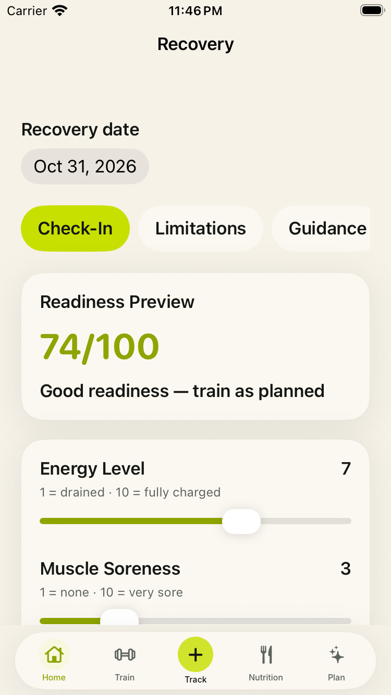
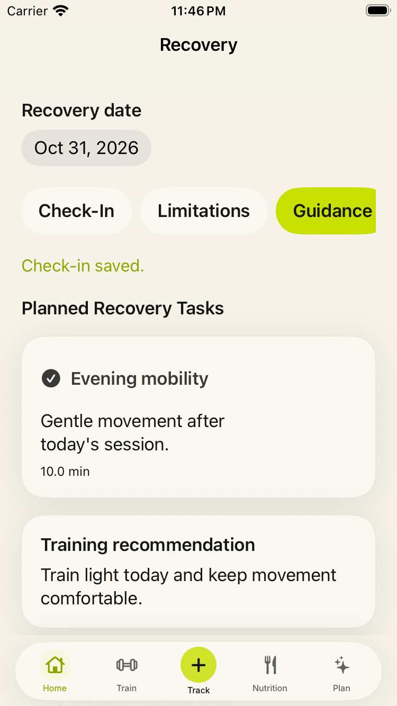
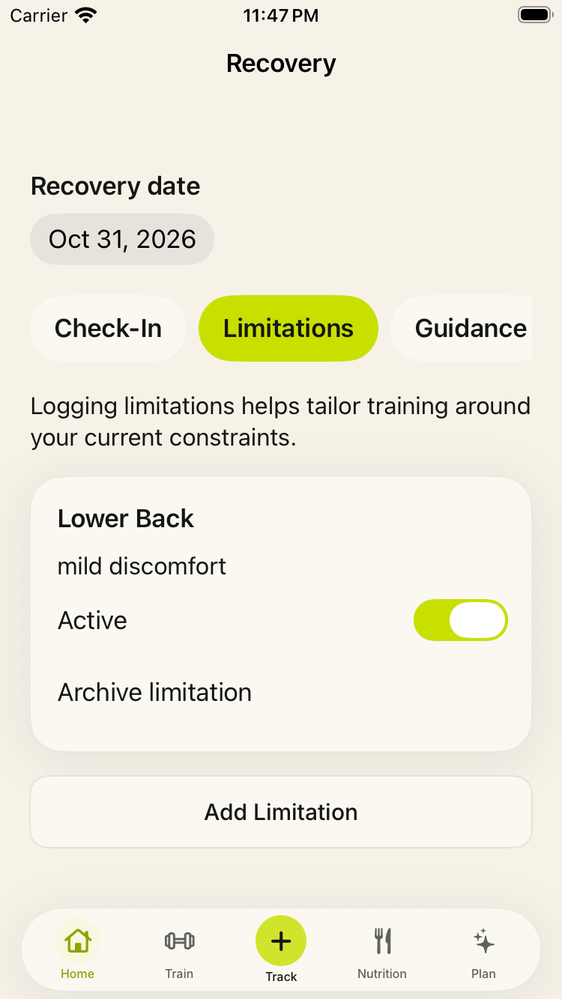
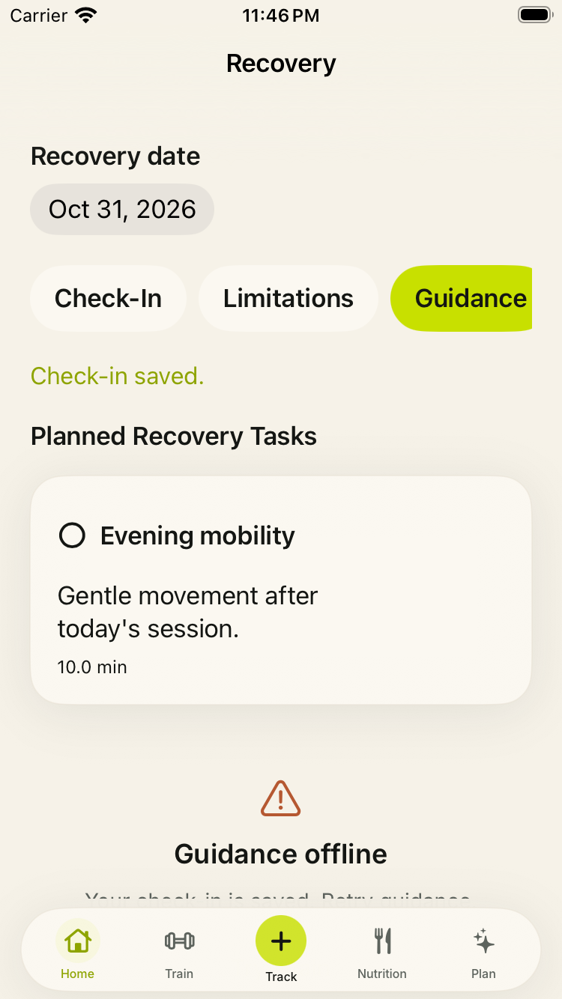

# Native iOS parity audit

> Test email addresses in this published log are anonymized. Exact identities and device evidence remain in the private setup workspace.

Last reviewed: 2026-11-08 for Recovery source-selection and retry follow-up; November 1 billing/setup evidence is preserved. Production Recovery and device QA remain open.

This ledger tracks the SwiftUI app against the existing Capacitor app. The Capacitor source remains a read-only behavioral reference until each required workflow is verified on a physical iPhone.

## Current native surface

| Area | Status | Native implementation | Remaining work |
| --- | --- | --- | --- |
| Startup and authentication | Partial | Native launch state, Supabase session restore, email OTP, Apple/Google OAuth, sign-out service | Validate callback handling, expiry, cancellation, and account recovery on device |
| App shell | Complete | Five native tabs, independent navigation stacks, full-screen routing, safe-area tab bar | Physical-device accessibility and rotation audit |
| Home | Partial | Native dashboard, customization, live data, cache, realtime, checklist mutations | Replace Progress, Insights, Goals, and My Week placeholder destinations |
| Train dashboard | Partial | Today, split, library, history, native plan data | Add plan-generation/editing parity and completed-session detail |
| Workout session | Implemented, needs device QA | Native plan loading, resume, autosave, sets, reps, weight, rest timer, skip/custom exercise, notes, check-in, completion, daily-log synchronization, summary | Verify production RLS writes, readiness recalculation parity, background/termination recovery, and real-data edge cases |
| Track | Partial | Native metric logging, manage metrics, food shortcut, completion state, tracking history | Verify every Capacitor metric and history action against production data |
| Nutrition | Partial | Native date navigation, meal plan, manual and AI logging, deletion, totals | Validate AI upload/error limits, saved recipes, and all premium gates |
| Plan | Partial | Native weekly plan, blueprint, adjustments presentation | Implement plan questionnaire/generation, editable adjustments, and regeneration flow |
| Recovery | Implemented; fixture acceptance, production QA open | Native selected-date check-in, preview/dynamic scores, limitations, structured guidance, canonical planned tasks, Home refresh | Verify production RLS/persistence and live invoke-llm using a separate disposable account; review proposed customization omission |
| Progress and insights | Missing | Typed routes only | Build charts, trends, goal linkage, date ranges, empty states, and sharing/export if retained |
| Goals | Missing | Typed route only | Build create/edit/archive goals and progress entries |
| Profile and settings | Implemented, needs device QA | Native display-name editing, unit preferences, notification settings handoff, subscription status, sign-out, and guarded permanent account deletion | Validate profile writes, notification handoff, sign-out, deletion, and cache/session cleanup against production on a physical iPhone |
| Billing | Implemented; purchase/renewal, A → B transfer, empty restore, reinstall and cancellation/expiry verified; webhook v8 deployed | Native paywall, localized prices, purchase/restore/manage, session-isolated gates and server reconciliation | Real refund/reversal and billing-grace acceptance, pending/interrupted purchases, mixed-provider cases and independent StoreKit Code=3 remain open |
| Onboarding | Missing | Typed route only | Port the required native questionnaire and first-plan handoff |
| Legal | Implemented, needs review | Native Privacy Policy and Terms screens available before and after authentication | Complete legal review and confirm production support/contact links before App Store submission |

## Release gates

- No `RoutePlaceholderView` is reachable from a production action.
- Every Capacitor workflow is marked retained, replaced, or intentionally removed.
- Production Supabase RLS, RevenueCat entitlements, OAuth callbacks, and account deletion are verified. The hardened `deleteUserData` Edge Function must be deployed before native deletion is considered complete.
- Loading, empty, offline, retry, expired-session, and permission-denied states are exercised.
- Unit tests cover calculations and mutations; UI tests cover sign-in, all five tabs, workout completion, food logging, and purchase restoration.
- VoiceOver, Dynamic Type, keyboard behavior, reduced motion, safe areas, and the smallest supported iPhone pass QA.
- Resolve the device-family policy before archive: either ship iPhone-only or add and validate every required iPad orientation. The generic device build currently warns because the app target advertises iPad support without declaring all orientations.
- Debug and Release simulator builds pass; a signed device archive uploads to TestFlight.
- App icon, launch presentation, privacy strings, privacy manifest, screenshots, support URL, privacy URL, and App Store metadata are complete.

## Recommended implementation order

1. Verify workout, Profile, Settings, legal links, sign-out, and profile writes against production data on a physical iPhone.
2. Deploy and validate the hardened `deleteUserData` Edge Function with a disposable production-like account.
3. Finish Billing sandbox/device acceptance below; the native implementation and mock route coverage are in place.
4. Build Recovery, Goals, Progress, Insights, and My Week in that dependency order.
5. Complete onboarding and plan generation/editing.
6. Run parity QA, expand automated tests, archive, and distribute through TestFlight.

## Billing implementation and evidence — 2026-10-15

**Stage:** the native Billing vertical slice is implemented and its unit/UI checks pass; StoreKit/sandbox acceptance remains open. The overall refactor is still in feature parity, with the missing destinations above and device release gates outstanding. Billing is not yet approved for live purchases.

### Baseline and implemented behavior

- Fetched `origin/native-dev`; both it and the reviewed baseline resolve to `b02a9fa81744b58c67bed522781aa1551a56270e`. Work is on local `codex/native-billing` based on that revision. No changes to `src/` or `ios/App/`.
- Baseline Debug build, unit-test build, and Release build were attempted with Xcode 26.4 (17E192), Swift 6.3, iOS 26.4 simulator. All three hit the same Swift IR generation crash in `TrainView.swift` while adapting `model.updateNotes` to a `Binding` setter. The explicit closure `{ model.updateNotes($0) }` preserves behavior and removes the compiler crash. Logs: `/tmp/execute-billing-validation/baseline-{debug,tests,release}.log`.
- `.billing` now opens `BillingView` from Profile's subscription action and Nutrition's premium AI gate. It includes monthly/annual selection, live localized RevenueCat `StoreProduct` prices, purchase, restore, App Store subscription management, existing Privacy/Terms routes and auto-renewal disclosures. Legal controls have 44-point hit targets and bottom-tab clearance.
- Loading, missing configuration/offerings, cancellation, pending approval, network errors/retry, and restore-with-no-active-purchase have distinct UI states. Existing web subscribers retain backend access and receive a web-management explanation.
- `BillingStore` shares premium state with Profile/Nutrition/AppState. It resolves the authenticated email's backend `plan=premium`, `status=active|trialing` record OR the exact live RevenueCat entitlement. Sources refresh independently; a failed source does not discard a previously confirmed same-session entitlement. Expired live entitlements do not grant access; active RevenueCat billing grace periods retain access until the grace period ends. No client writes to `user_subscriptions` were added.
- RevenueCat uses the authenticated email unchanged. SDK identity changes, reads, purchases, restore, and management are serialized. Session/request generations discard prior-account and pre-purchase results. Sign-out immediately revokes billing access, including logout network failure; successful deletion clears it, while failed deletion preserves the signed-in account. Purchase, restore, customer-info updates, and foregrounding refresh gates.

### Automated validation

- Initial **Debug and Release simulator builds passed** on 2026-10-15 for `generic/platform=iOS Simulator` (arm64 and x86_64), using `CODE_SIGNING_ALLOWED=NO`. Logs: `/tmp/execute-billing-validation/billing-final-Debug.log` and `billing-final-Release.log`. The only build warning was skipped App Intents metadata extraction because the app has no AppIntents dependency. No signed-device archive or TestFlight upload was attempted. Follow-up evidence is below.
- Initial unit/UI run on 2026-10-15: **69 unit tests and 3 UI tests passed, zero failures**, on iPhone 17 Pro / iOS 26.4. Result: `/tmp/execute-billing-derived/Logs/Test/Test-ExecuteNative-2026.10.15_21-28-42--0700.xcresult`; log: `/tmp/execute-billing-validation/billing-final-tests.log`. The test invocation used `-parallel-testing-enabled NO -skip-testing:ExecuteNativeTests/StoreKitBillingTests CODE_SIGNING_ALLOWED=NO`.
- Billing/account tests cover backend statuses, expired live access and active grace periods, independent backend/SDK outages, foreign rows, switching emails, delayed login, sign-out during a read, stale purchase/restore/backend results, failed identity verification, no offerings/retry, purchase success/cancel/pending/network retry, restore success/empty/error, management errors, duplicate taps, foreground changes, and successful/failed deletion (mock backend only).
- Three simulator UI tests use the DEBUG-only `-execute-billing-ui-tests` service fixtures: Profile → Billing → purchase; Nutrition → Billing → restore; empty restore → Privacy → back → Terms. These verify the actual native routes and UI state, **not** live StoreKit transactions. Prices shown in screenshots are fixture prices.
- Local StoreKit integration: **4 tests attempted, 4 failed before transactions** on the only installed runtime, iOS 26.4 (23E244), iPhone 17 Pro. `SKTestSession` logs `Error saving configuration file: SKInternalErrorDomain Code=3`; product loading returns zero products. Repeating with normal ad-hoc simulator signing produced the same result. Logs: `/tmp/execute-billing-validation/billing-integration-tests.log` and `billing-storekit-signed-tests.log`; signed-run result: `/tmp/execute-billing-derived/Logs/Test/Test-ExecuteNative-2026.10.15_21-20-23--0700.xcresult`. The symptom matches Apple's [reported StoreKit test-session issue](https://developer.apple.com/forums/thread/826971); this is an environment diagnosis, not a passed test or proof that purchase behavior is correct.
- The four StoreKit tests remain enabled in the project. The passing unit/UI command explicitly excludes `ExecuteNativeTests/StoreKitBillingTests`; see `ios-native/README.md`. Do not describe that subset as an entirely passing sandbox suite.

### Follow-up implementation and validation — 2026-10-16

- Closed additional authentication races: a late startup result/failure, OTP result, or OAuth callback cannot replace a newer account or revive a signed-out account. Supabase OTP/callback/logout mutations share a serial queue so their SDK session writes finish in request order; startup session reads retain their existing timeout/cancellation behavior.
- Logout cache deactivation and successful-deletion cache purging now target the original user UUID. A delayed response cannot clear a newer user's cache. Deletion also avoids logging out a newer sign-in that has started but not yet completed.
- Added **9 focused regression tests** for those paths and failed authentication queue recovery. Final unit/UI validation: **78 unit tests and 3 UI tests passed, zero failures**, on the same iPhone 17 Pro / iOS 26.4 simulator. Result: `/tmp/execute-billing-derived/Logs/Test/Test-ExecuteNative-2026.10.16_00-39-09--0700.xcresult`; log: `/tmp/execute-billing-validation/billing-completion-tests.log`. The four StoreKit tests were explicitly excluded, as above. Account/backend behavior in these tests uses controlled doubles; real Supabase and RevenueCat account switching still requires sandbox/device acceptance.
- Final **Debug and Release generic simulator builds passed** with the completed source and prepared public local configuration, for arm64 and x86_64 with `CODE_SIGNING_ALLOWED=NO`. Logs: `/tmp/execute-billing-validation/billing-completion-Debug.log` and `billing-completion-Release.log`. Only the expected App Intents metadata warning remained. Diff whitespace checks passed; `src/` and `ios/App/` remain unchanged. Work remains local and uncommitted on `codex/native-billing`.
- Added the shared `ExecuteNative-StoreKit` scheme and matching `project.yml` definition. It selects only the four StoreKit tests and attaches the local fixture for Xcode Run. The ordinary `ExecuteNative` scheme remains fixture-free for real sandbox testing.
- Retried local StoreKit through **Xcode IDE Run → Stop → Test**. The fixture annual purchase sheet appeared with the Xcode test label, but `SKTestSession` reset, transaction cleanup, disabled-dialog, and Ask to Buy overrides still emitted `SKInternalErrorDomain Code=3`. The first pending-purchase test stalled at the normal purchase sheet and was canceled; **0 passed, 1 canceled failure, 3 not reached**. Result: `/Users/evanlycos/Library/Developer/Xcode/DerivedData/ExecuteNative-atyvvfmdkacvtkdlajznuwgxctsc/Logs/Test/Test-ExecuteNative-StoreKit-2026.10.16_00-31-58--0700.xcresult`; exported summary: `/tmp/execute-billing-validation/billing-storekit-ide-summary.json`. No purchase was confirmed. This retries the debugger workaround without converting an environment failure into a false pass.
- Prepared ignored `ios-native/Configuration/Local.xcconfig` with the existing public Supabase client URL/anon key. At that stage the RevenueCat key was blank; the verified native-dev key is now set as recorded below. Added an [Apple/RevenueCat setup walkthrough](../ios-native/README.md#resolve-the-native-dev-configuration) with bundle/product matching, public key placement, restore policy review, and device sandbox steps. Provider credentials, production configuration, and backend deployment were not changed.

### RevenueCat and backend verification

- **Verified dashboard/configuration update — 2026-10-16:** Explicit native-dev App ID is registered under Apple Developer team `58GZDC8UKY`. App Store Connect **Execute Native Dev** has Apple ID **6823713820**, bundle `com.executelabs.execute.native-dev`, SKU `execute-native-dev`, iOS, English (U.S.), and Limited Access. Paid Apps Agreement and displayed banking/tax statuses are Active. RevenueCat project `7415d2f3` now contains matching app **appf70a718df8**, with user-approved reuse of its stored Apple credentials (both marked valid). Its public iOS SDK key is configured in ignored `ios-native/Configuration/Local.xcconfig`. The existing Execute app was preserved.
- **Native-dev products saved — 2026-10-17:** Group `execute_premium` (**22487071**), English (U.S.) localization **Execute Performance Premium**, app-name display **Execute Native Dev**. Monthly `execute_native_dev_premium_month` (Apple product ID **6823895783**, 1 month) is **CAD 15.00 / USD 12.00**. Annual `execute_native_dev_premium_annual` (**6823896241**, 1 year upfront) is **CAD 100.00 / USD 70.00**. Exact CAD choices were user-approved; USD values are Apple automatic equalization. Both are available only in **Canada and United States**, without future-country expansion. RevenueCat imported both and attached them to entitlement **Execute Performance Premium** and current offering **default**, packages `$rc_monthly` / `$rc_annual`; original-app mappings were preserved. Local overrides match the unique native-dev IDs. Products remain **Prepare for Submission**, with review screenshots and app-version submission outstanding. At this stage the default levels were monthly 1 and annual 2, UI drag attempts had not saved a change, and real sandbox retrieval was unverified. The 2026-10-21 live-metadata/level-alignment follow-up below supersedes those setup findings.
- **Notifications and restore:** RevenueCat applied server notifications; both Apple production/sandbox URLs were verified. Apple → RevenueCat delivery remains unverified. Restore behavior is **Transfer to new App User ID**, without a sandbox override, and remains unchanged. A restore/new purchase from a different identified account can move the receipt and revoke the previous account's live entitlement. Review account recovery and backend transfer handling before A → B acceptance.
- **Restore/backend risk:** At the initial audit, repository `supabase/functions/revenuecatWebhook/index.ts` acknowledged `TRANSFER` without reconciling source/destination subscription rows. The tested follow-up below replaces that behavior and is now deployed as version 7; live customer/writeback and A → B acceptance remain pending. Because native backend premium state can grant access independently of the live entitlement, a provider-side transfer can leave stale backend access for the former owner. Downloaded deployed version 5 also skips `TRANSFER`, confirming this behavior in production source. Keep the project-wide restore policy unchanged pending review and use disposable Execute identities for sandbox acceptance.
- **Initial webhook delivery blocker (resolved by the approved gateway follow-up below):** RevenueCat integration Supabase targets **all apps / all events / both production and sandbox**. A synthetic **TEST** event (`57B2F7A4-E15D-4427-BD04-2F075028FBD4`) returned **HTTP 401**, `UNAUTHORIZED_INVALID_JWT_FORMAT` / `Invalid JWT`, from the Supabase gateway. Read-only deployed metadata confirms `revenuecatWebhook` **ACTIVE version 5, verify_jwt=true**; repository config is already `false`. Downloaded deployed source independently checks `Bearer REVENUECAT_WEBHOOK_SECRET` before parsing or writing. The scoped fix proposed at that stage was changing only this function's gateway `verify_jwt` to `false`, retaining that secret check, then repeating TEST and unauthenticated rejection checks. Production configuration initially remained unchanged pending user approval; no receipts or customer rows were fabricated. Synthetic TEST delivery does not prove real Apple purchase processing. See [Supabase auth layers](https://supabase.com/docs/guides/functions/auth-headers).
- **Signing:** Verified the native-dev App ID under `58GZDC8UKY`; updated the native app's old `8Y298D8N52` team and set the app/test targets plus `project.yml` to `58GZDC8UKY`. The device build compiled and selected a matching team/profile, but Xcode packaging failed because the generated app under synced Documents had `com.apple.FinderInfo`. A clean temporary copy of only the generated app was re-signed and passed `codesign --verify --deep --strict`, then installed successfully on the connected iPhone as `com.executelabs.execute.native-dev`. No sandbox transaction has passed. After creation of unique native-dev product IDs, the temporary artifact Info.plist was updated to match ignored xcconfig and re-signed; strict/deep verification passed. Reinstallation failed because CoreDevice could not locate/initialize the iPhone. The earlier installed artifact has stale product IDs and must be replaced before acceptance.
- **Local StoreKit follow-up:** Targeted Xcode IDE run at 10:52 on 2026-10-16 passed `testMonthlyAndAnnualProductsExposeLocalizedPriceAndPeriod`: **1 test, 0 failures**, both local products returned expected price/period metadata. The same run still emitted `SKInternalErrorDomain Code=3` during configuration saving, override clearing, transaction deletion, and setting a test-session option. Product loading now has a narrow pass; test-session controls, purchase/sync, cancellation, pending approval, RevenueCat receipts, and Apple's real sandbox remain unverified.
- Read-only RevenueCat API requests with the existing web iOS public SDK key returned current offering `default`, package `$rc_monthly` → `execute_premium_month`, and `$rc_annual` → `execute_premium_annual`. Product/entitlement mapping returns **`Execute Performance Premium`** for both products, not the old documented `premium`. Native defaults and example configuration now use that exact identifier. Responses are recorded without credentials at `/tmp/execute-billing-validation/revenuecat-{offerings,product_entitlement_mapping}.json`.
- Sending a native-dev bundle header alone does not prove registration; registration and the matching RevenueCat app/key are now verified separately above. Saved storefront availability/prices are verified above; device retrieval and real purchase, restore, webhook, renewal, refund, and cancellation acceptance remain open. Local StoreKit fixtures do not substitute for that verification.
- **Hardened deletion is not deployed.** Supabase CLI 2.101.0 listed `deleteUserData` as ACTIVE **version 5**, updated **2026-05-26 01:48:21.793 UTC**. Downloading the deployed source via the management API confirmed it lacks local Stripe cancellation, upload cleanup, failed-table checks, and `auth.admin.deleteUser`. Deployed source SHA-256: `fcac432ade88b3e07284ae36ff6b9251aa2b61a56d84a91aa2c11b829cc03fab`; repository source: `3cc505afdcc1799b95e0a23bf9230f4e11627edc2f317d6b30629a9331dc3a01`. Evidence: `/tmp/execute-billing-validation/deployed-functions.json` and `/tmp/execute-billing-deployed/supabase/functions/deleteUserData/index.ts`. No deployment or destructive deletion test was performed. A successful client-side deletion mock does not close this release gate.

- **Further local StoreKit attempt:** Created an isolated iOS 26.4 simulator and attempted the cancellation-only test. The machine reached critically low free disk space during build; the run was stopped before any test result. Removed only this task's generated build caches and disposable simulator, retaining logs and the verified signed app. This attempt supplies no StoreKit pass/fail evidence; the prior Code=3 failure remains unresolved. Only iOS 26.4 (23E244) is installed.

### Device and deployment readiness — 2026-10-21

- At the start of this readiness check, read-only deployed metadata reconfirmed `revenuecatWebhook` **ACTIVE v5 / verify_jwt=true**. The subsequent approved repair and verification are recorded below.
- CoreDevice now lists the development iPhone as **connected**. The old temporary app directory was missing `Info.plist` and executable content and could not be reused.
- A **fresh signed Debug device build passed** using ordinary `ExecuteNative`, with DerivedData at `/private/tmp/execute-native-qa-20261021/DerivedData` outside synced Documents. This avoids the earlier Finder-metadata packaging failure; no source or signing policy changes were needed for this build.
- `codesign --verify --deep --strict` passed; signing team is **58GZDC8UKY**. Built public billing settings match ignored `Local.xcconfig`, including the exact native-dev bundle, monthly/annual IDs, SDK key, entitlement and offering. The ordinary scheme remains fixture-free and has no mock launch arguments.
- Installation on the connected iPhone **succeeded**, superseding the stale-ID installation and previous CoreDevice blocker. No launch, purchase, restoration, receipt, backend writeback or notification acceptance was performed.
- Xcode remains **26.4 (17E192)**; the only installed simulator runtime remains **iOS 26.4 (23E244)**. Free disk space was about **10 GiB** before this build. At this readiness stage no new local StoreKit result was claimed; the subsequent isolated retest below reproduced **Code=3**.
- Build log retained at `work/native-validation/device-build-20261021.log` in the setup chat workspace. The user subsequently approved the scoped gateway repair and confirmed sandbox tester/disposable Execute account readiness. At this stage equivalent Apple service levels and review screenshots remained open; subsequent level alignment is recorded below.

### Approved gateway fix and authentication verification — 2026-10-21

- The user explicitly approved changing only deployed `revenuecatWebhook` gateway `verify_jwt` to `false`, retaining its existing bearer-secret authentication. Applied this setting in the existing Supabase function settings; no code redeployment, credential change, or other function setting was performed.
- Readback confirms **ACTIVE v5 / verify_jwt=false** with unchanged source-bundle SHA-256 `9cab4c31d1a5b4eb6b593fb62f4dad67a0ee4c65b216cd794b5d18ccc5b1ee6a`.
- RevenueCat's synthetic **TEST** event **3DF65227-B284-455F-83CA-B96D7AFE4081** returned **HTTP 200**, `{"received":true,"skipped":"TEST"}`. This is RevenueCat's generic test-store event, not a native-dev Apple purchase or receipt. The handler acknowledges TEST without writing a subscription row.
- Two negative checks to the existing webhook URL (missing Authorization, invalid bearer) both returned handler-level **HTTP 401**, `{"error":"Unauthorized"}`. Authentication is still enforced by the deployed secret check. No secret value was exposed or copied.
- The gateway delivery blocker is closed. Real Apple → RevenueCat notification delivery, receipt processing, legitimate purchase → backend writeback, and `TRANSFER` reconciliation remain unverified/open.
- The user confirmed the Sandbox Apple Account and disposable Execute login are ready. The attempted device launch was denied because the iPhone was locked; asked the user to unlock/open the app and report paywall metadata plus the disposable app-user email. The user subsequently completed App Store Connect sign-in. At this stage service-level alignment and review screenshots remained open; the subsequent manual level save is recorded below.

### Isolated StoreKit retest and running simulator inspection — 2026-10-21

- A fresh disposable iPhone 17 / iOS 26.4 simulator ran only `StoreKitBillingTests/testCancellationDoesNotCreateAnEntitlement` through `ExecuteNative-StoreKit`: **1 test, 1 failure**, 7.448 seconds, `xcodebuild` exit **65**. `SKInternalErrorDomain Code=3` recurred for saving configuration, clearing overrides/transactions, and setting the disabled-dialog option. The actual test failure was `XCTUnwrap` of a nil `Product` at line 65; no purchase occurred.
- Preserved `work/native-validation/storekit-cancellation-20261021.log` and `Test-ExecuteNative-StoreKit-2026.10.21_12-47-12--0700.xcresult` (49 MB) in the setup chat workspace. Removed only the disposable QA simulator afterward, leaving the user’s running iPhone 17 simulator intact. This retest closes no transaction acceptance item.
- Rechecked [Apple’s matching forum thread](https://developer.apple.com/forums/thread/826971): DTS reported a fix in Xcode 26.6 RC; later users still report similar failures, including IDE tests. Treat a toolchain/runtime change as a candidate experiment, not a verified fix. Installed Xcode/runtime remain 26.4.
- At the user’s request, inspected the existing running simulator instead of requiring iPhone Mirroring unlock. Profile → Upgrade to Premium reproduced “Destination ready” / billing awaiting migration. Current source already routes `.billing` to `BillingView`, so no source rewrite was made for the old running app.
- A fresh ordinary-scheme simulator build **passed**, then installed over the native-dev app without erasing its data. Launched without mock arguments or StoreKit configuration; it reached normal sign-in. Asked the user to authenticate the disposable Execute account before checking the current billing screen. The prior preview/profile identity is not accepted as proof of an authenticated disposable test account.
- Real sandbox product retrieval, purchases, restore, pending approval, Apple → RevenueCat notifications and legitimate backend writeback remain unverified. The gateway TEST/authentication checks above are independent passes.

### Live billing metadata and Apple service levels — 2026-10-21

- The user signed into Execute by email in the freshly installed ordinary simulator app. Profile → Upgrade to Premium now opens **Premium & Billing**, replacing the old running build’s placeholder. Both live offering options load: monthly **$12.00 / month**, annual **$70.00 / year**. StoreKit logs subsequently confirmed **USA / USD**, matching the saved US storefront amounts. Purchase-sheet metadata still needs confirmation. This is a metadata/navigation pass, not transaction acceptance.
- Selecting Monthly updated the subscribe action to **$12.00 / month**. Starting that test purchase reached Apple’s “Sign in to Apple Account” prompt. Asked the user to authenticate the Sandbox Apple Account there and leave any purchase-confirmation sheet open. No purchase confirmation, receipt, entitlement activation, restore or backend writeback has been verified.
- Clarified the distinct authentication paths: Execute email login identifies the app user; the Sandbox Apple Account authenticates test purchases through Apple. A failed attempt to use the sandbox account with Execute’s Continue with Apple does not establish a sandbox-purchase login failure.
- The user manually saved the equivalent-service level adjustment. App Store Connect readback shows both products at **level 1**. Review screenshots and first app-version submission remain outstanding; no App Review submission was made.
- After the user’s first sandbox authentication attempt, the app and SDK reported **purchase canceled**; retrying returned to a blank Apple account prompt. The user confirmed pressing OK, not Cancel. Apple-service logs then established **sandbox authentication failure**: `AMSErrorDomain Code=100`, underlying code **2** (password reuse unavailable for account state) and **0** (unrecognized authentication failure). AuthKit reported success, but Apple Media Services credential verification failed. This does not prove an incorrect password. [Apple DTS recommends a physical device for the matching simulator failure](https://developer.apple.com/forums/thread/768966). Asked the user to prepare the properly signed physical iPhone, use Execute email login and Apple Settings → Developer sandbox sign-in, then unlock Mirroring for inspection. Credential-free log excerpts/attempt summary are retained at `work/native-validation/sandbox-purchase-attempt-summary-20261021.json` in the setup chat workspace.
- RevenueCat readback for the signed-in email alias shows **no current entitlements**, current offering `default`, and historical original-app subscription/transfer events. Those older events do not verify a native-dev purchase or a clean no-purchase restore baseline. No customer data, entitlement grants, aliases or restore policy were changed.
- Relaunched only the simulator app while preparing clean review screenshots; it returned to normal authentication. Session persistence requires a signed-device comparison before attributing this to application code. No app data was erased and no authentication/storage implementation was changed. Review screenshots still need a clean device-resolution capture; the workspace billing-window screenshot is evidence, not an uploaded review asset.
- The independent local StoreKit Code=3 failure above remains unresolved. Successful live offering retrieval and the webhook TEST do not validate SKTestSession controls.

### Physical-device comparison prepared — 2026-10-21

- User connected the physical iPhone and unlocked Mirroring. Because the installed version could be stale and both apps display **Execute**, reverified the fresh ordinary-scheme signed artifact using the host trust store; strict/deep verification **passed**. Reinstalled only `com.executelabs.execute.native-dev`, preserving its app data and leaving original `com.executelabs.execute` untouched. Installation and exact-bundle launch **succeeded**.
- Built native-dev monthly/annual product IDs, entitlement and offering still match the approved configuration. Executable SHA-256: `66d74f7e5eca4c666978103983092c80ef9aac70da9ee2fd0cf3417432640e3b`. Refresh evidence: `work/native-validation/device-refresh-20261021.json` in the setup chat workspace.
- Xcode reports physical **iPhone 17 / iOS 26.6.1 (23G83)**. This comparison is distinct from local StoreKit tests and the iOS 26.4 simulator sandbox-authentication failure.
- Mirroring displayed normal Execute email sign-in after the exact-bundle launch; asked the user to complete login and open Premium & Billing. No physical-device purchase, restore or receipt acceptance has been performed. Xcode Devices exposes **Take Screenshot** for the eventual full-resolution review assets; none has been captured/uploaded yet.


### Physical monthly sandbox acceptance — 2026-10-21

- On the freshly signed ordinary `ExecuteNative` build (StoreKit Configuration **None**), the physical iPhone loaded **CAD 15/month** and **CAD 100/year**. Apple explicitly identified the transaction as **Sandbox**, for testing without a charge. The user completed Apple's password authorization. Apple displayed **Your purchase was successful** and the app displayed **Premium active**.
- RevenueCat recorded native-dev **INITIAL_PURCHASE** event `9D8BFE2D-815C-4562-B7D1-56D947E3CD2A` for app `appf70a718df8`, product `execute_native_dev_premium_month`, environment **SANDBOX**, country **CA**, currency **CAD**, price **15**, offering `default`, and entitlement **Execute Performance Premium**. Purchase time was **2026-10-21 20:20:16 UTC**, initial sandbox expiry **20:25:16 UTC**. The signed-in email is an alias of a customer with original-app history; this was not a clean new-customer baseline.
- The actual purchase event's Supabase integration attempt returned **HTTP 200**, `{"received":true}`. A read-only SQL check independently found exactly **one** matching subscription row: `plan=premium`, `status=active`, the exact native-dev monthly product, `environment=SANDBOX`, `store=app_store`, and the matching initial period. Updated time was **20:20:42.058 UTC**. No subscription row was manually written to manufacture acceptance.
- **Same-account restore passed:** Restore Purchases displayed **Your App Store purchase was restored** and retained Premium active. This does not establish no-purchase restore, reinstall/restore, or receipt transfer between Execute accounts.
- Captured and visually checked a clean physical-device billing review PNG, **1206 × 2622**, showing both approved CAD prices. Workspace asset: `outputs/native-dev-billing-review.png`. Upload status is recorded in the later review-upload follow-up; capture alone is not proof of a saved Apple attachment.
- **Management handoff remains open:** Manage App Store Subscription opened Apple's Sandbox card for an old original-app annual subscription, canceled in June, offering renewal at **CAD 99.99**. No renewal/change was made. Source inspection confirms the current RevenueCat SDK calls Apple's general `AppStore.showManageSubscriptions(in:)` on this iOS version; it does not pass a subscription-group filter. The displayed old card does not establish native-dev plan-change/cancellation acceptance.
- Monthly receipt processing, entitlement activation, legitimate webhook/backend writeback and same-account restore now have a scoped physical-device pass. Annual purchase, pending approval, reinstall/session persistence, account switching/TRANSFER reconciliation, management, expiry/renewal/refund and Apple → RevenueCat notification transport remain unverified. Project-wide restore policy remains unchanged. The independent simulator authentication failure and local StoreKit **Code=3** remain unresolved; this physical purchase does not validate SKTestSession controls.
- Credential-free evidence is retained in the setup chat workspace at `work/native-validation/monthly-sandbox-acceptance-20261021.json`, with purchase-success, Premium-active and same-account-restore screenshots in `outputs/`.


### Renewal, management and relaunch follow-up — 2026-10-21

- RevenueCat subsequently recorded native-dev monthly renewals at the accelerated sandbox interval. Inspected renewal `FED17264-09A0-422D-B3C5-40BC80F7E958`: correct app/product, **CAD 15 / SANDBOX**, Supabase **HTTP 200**, `{"received":true}`. A later read-only query still returned exactly one `premium/active` row, now with period **20:30:16–20:35:16 UTC**, updated **20:29:31.040092 UTC**. This establishes renewal processing and backend-period advancement; the dashboard does not independently identify Apple server-notification transport as the source.
- The general Apple Sandbox subscription list finished loading and showed **Execute Native Dev / Monthly / CAD 15** under Active, and the old original-app annual subscription separately under Inactive. Opening the native-dev card and **See All Plans** displayed **CAD 15/month** and **CAD 100/year**. This supersedes the earlier concern that management only reached the original app; no source change is indicated by that concern.
- Selecting Annual and Change Subscription did not produce a confirmation/success; the Apple plan sheet also stopped responding to Close. Home navigation still worked. Cleared the sheet by terminating/relaunching only the exact native-dev bundle. **No annual transaction or plan-change pass is claimed.** The old original-app subscription was not changed.
- The signed physical app relaunched with the same authenticated email session. Profile and Premium & Billing still showed **Premium active**. This is a physical-device process-relaunch/session-and-entitlement pass, not reinstall/restore or proof about the earlier simulator session.
- The user approved enabling **Allow access to file URLs** for ChatGPT in Chrome profile `fresh-sandbox-tester@example.com`; enabled and verified that specific permission. Attached the prepared billing PNG to the **Review Information → Screenshot** field of both native-dev subscriptions. Apple currently displays **Processing native-dev-billing-review.png** with **Save disabled**. Upload processing is not yet a verified saved attachment; no App Review submission was made.


### Review screenshots saved — 2026-10-21

Both native-dev subscriptions now have the prepared full-resolution physical-device billing screenshot saved in **Review Information → Screenshot**. Reloaded monthly `6823895783` and annual `6823896241`: each displayed a server-hosted Apple image (`mzstatic.com`, 1206 × 2622), with no Processing label. The upload saved automatically; the earlier Processing display/disabled Save was stale. The original PNG succeeded. A JPEG was prepared for troubleshooting but was not uploaded or needed. No promotional image, price, availability, original-app record, credential or restore policy was changed. Both products remain **Prepare for Submission**; no App Review submission was made. Saved-page proof is retained as `outputs/apple-monthly-review-saved.png` and `outputs/apple-annual-review-saved.png` in the setup chat workspace.

Reopening the native-dev Apple plan sheet after app relaunch again displayed the correct annual CAD 100 option, but Change Subscription did not produce a confirmation through Mirroring. Asked the user to try the annual Sandbox change on the physical iPhone and handle any Apple authorization. Annual receipt/plan-change acceptance remains open pending that result.


### Annual preference and Apple notification reception — 2026-10-21

The user successfully changed to annual on the physical iPhone. RevenueCat recorded **PRODUCT_CHANGE** `F4DE8E9A-17DB-4106-AC8B-A56B15460CE0`, environment **SANDBOX**, current monthly product and `new_product_id=execute_native_dev_premium_annual`; its Supabase webhook returned **HTTP 200**. The current monthly period ends **20:40:16 UTC**. This establishes a saved renewal preference, not yet an annual transaction: [Apple applies same-level changes between different durations at the next renewal](https://developer.apple.com/app-store/subscriptions/). Actual annual receipt/backend verification follows separately.

The native-dev RevenueCat app configuration independently reports **Apple Server to Server Notifications configured correctly** and **Last received 2026-10-21, 8:34 p.m. UTC**. This closes the earlier lack of direct Apple → RevenueCat reception evidence for this app. It does not attribute any particular renewal event to that transport. No URL or notification setting was changed during this readback.


### Annual crossgrade and receipt acceptance — 2026-10-21

- The scheduled change took effect at the next sandbox renewal. RevenueCat **RENEWAL** event `48F81582-AFB7-40EF-B3FE-94197490CD01` contains app `appf70a718df8`, exact product `execute_native_dev_premium_annual`, **CAD 100**, **CA / SANDBOX / APP_STORE**, offering `default`, and entitlement **Execute Performance Premium**. The accelerated annual period is **20:40:16–21:40:16 UTC**.
- That annual event's Supabase integration returned **HTTP 200**, `{"received":true}`. The same narrow read-only SQL check returned exactly **one** `premium/active` row, now with the **annual** native-dev product and matching period, updated **20:39:48.656029 UTC**. No backend data was manually edited.
- Annual plan management, scheduled crossgrade, effective annual transaction, receipt processing and backend product/period update now have a scoped pass. This is **monthly → annual crossgrade/renewal**, not a fresh annual purchase from a free account. Device Premium/session and same-account restore were verified during the earlier monthly phase; post-crossgrade device UI refresh is not separately claimed.
- Review screenshots are saved on both products. Direct native-dev Apple → RevenueCat notification reception is verified by its dashboard status/last-received readback. Original Execute records and the project-wide restore policy were preserved.
- Remaining acceptance includes an initial annual in-app purchase, pending/approval, cancellation/expiry/refund, no-purchase and reinstall/restore, interrupted-network/account-switch cases, and `TRANSFER` backend reconciliation. Local **SKInternalErrorDomain Code=3** remains unresolved on Xcode/iOS simulator 26.4. No app source change, toolchain upgrade, App Review submission, or further production deployment was made for these checks.
- Evidence: setup chat workspace `work/native-validation/annual-sandbox-acceptance-20261021.json`; the shared Execute Document Progress Log records the exact scope.


### Transfer reconciliation prepared locally — 2026-10-21

A local fix is now present in `supabase/functions/revenuecatWebhook/`, with additive migration `20261021000000_reconcile_revenuecat_subscriptions.sql`. **The scoped rollout and completed physical A → B restore acceptance are recorded below; other sandbox acceptance cases stay open.** Transfer payloads have no `app_user_id`; the old early identity check silently acknowledged them. The new handler reads both transfer participant arrays, refreshes current RevenueCat entitlement state for email identities, preserves legitimate retained purchases/Stripe access, and applies all rows in one revision-checked transaction. Other supported RevenueCat lifecycle events also refresh current state so delayed events cannot replay obsolete grants or revocations. Anonymous IDs never create email-keyed rows. Inbound bearer authentication and the existing gateway configuration are retained; the project-wide restore policy is unchanged.

Validation: **17 handler tests passed**, **6 PostgreSQL transaction/access scenarios passed in isolated PGlite**, plus entrypoint type checking, lint and whitespace checks. Provider fixtures/transaction tests are not production or sandbox transfer acceptance. A read-only lookup using the existing native-dev public SDK key also confirmed the documented customer response shape; it did not mutate Supabase or establish project-wide credential scope.

The originally required key setup, scoped approval and migration/function deployment were completed in the rollout below. Preflight found no Stripe-linked rows; Stripe credentials remain a prerequisite if such rows are later reconciled. The migration deletes no rows and fails on duplicate emails; do not apply unrelated pending migrations. Use two fresh disposable Execute identities and a fresh sandbox tester without the original-app history for the live transfer. Existing stale rows need reviewed event replay after rollout. The existing Stripe webhook's later writes to the shared effective status are a separate dual-purchase-account limitation. See the [webhook rollout and rollback guide](../supabase/functions/revenuecatWebhook/README.md).

### Transfer reconciliation rollout — 2026-10-21 (2026-10-22 UTC)

- After scoped approval, the user privately created the RevenueCat REST API **v1** project key and saved `REVENUECAT_SECRET_API_KEY` in Supabase project `shoflbdwlmvttidoolvd`. Only key name/version/presence were verified; no raw key was copied into source or chat.
- Live preflight found **5 subscription rows, zero duplicate email identities, and zero Stripe-linked rows**. Applied only migration `20261021000000_reconcile_revenuecat_subscriptions.sql` and recorded that exact version in migration history. The new unique email index is valid; the reconciliation RPC is security-invoker, executable by `service_role` and not `anon`/`authenticated`; table RLS remains enabled. No rows were deduplicated or deleted. `STRIPE_SECRET_KEY` is absent: any future Stripe-linked reconciliation requires that credential and otherwise fails for retry.
- Deployed only `revenuecatWebhook` from an isolated four-file package matching the tested repository sources. It is **ACTIVE version 7**, with **`verify_jwt=false`** and the existing bearer authentication retained. Restore policy, Apple/product mappings and other function source were not changed. Prior deployed source is backed up for rollback in the setup workspace.
- RevenueCat TEST **`81273CE2-68B6-4606-9637-08D90EFBA4D7`** returned **HTTP 200**, `{"received":true,"skipped":"TEST"}`. Missing and invalid bearer requests both returned **HTTP 401**, `{"error":"Unauthorized"}`. The deployed source matches the code that passed 17 handler tests and 6 isolated PostgreSQL scenarios.
- **At rollout, live customer reconciliation and A → B transfer acceptance remained unverified; the subsequent fresh-A purchase/writeback pass is recorded below.** RevenueCat's UI offers Retry only for failed deliveries; a manual replay of the previously successful native annual event was prepared but never sent because the saved bearer value is masked. No historical failed original-app event was retried. The next fresh sandbox purchase must verify the server key, provider lookup, atomic RPC and backend writeback before testing the transfer. Deployment and synthetic TEST do not establish those passes.
- Use two fresh disposable Execute email identities and a new Canadian Sandbox Apple Account without original-app purchase history. Buy as A, restore as B with the same sandbox Apple account, then verify both provider/backend ownership and Profile/Nutrition gates. Existing stale rows still require reviewed reconciliation; later Stripe lifecycle writes remain a separate shared-status limitation. Independent local StoreKit **Code=3** remains unresolved.

Evidence: setup workspace `work/transfer-deployment-20261021/deployment-manifest.json` and `auth-negatives.json`; see the [rollout/rollback guide](../supabase/functions/revenuecatWebhook/README.md).

### Fresh-account email sign-in blocker — 2026-10-21

Disposable account A's first email request created its Supabase identity at **10:11:21 p.m. America/Vancouver**. The email was confirmed at **10:11:33 p.m.**, but `last_sign_in_at` remained null. The user received a confirmation link with no code and could not complete native sign-in. No expired-token error was captured, so this is not evidence that the token itself was stale.

Read-only dashboard inspection found that **Confirm sign up** originally contained only `{{ .ConfirmationURL }}`, while **Magic link or OTP** already contains `{{ .Token }}` and code instructions. The native UI expects a code for both cases. The exact native-dev callback `com.executelabs.execute.native-dev://login-callback` is already allowed; the fallback Site URL is still `http://localhost:3000`. Neither URL was changed. The project uses the built-in mail service with a displayed **2 emails/hour** quota, which may limit repeated email-based QA; no 429 is claimed.

With explicit user approval, the **Confirm sign up** template was saved with `{{ .Token }}` and native code-entry instructions, retaining its subject and existing confirmation link. Reload verified the exact saved body; the returning-user template remained byte-for-byte unchanged. The original templates and saved-preview screenshot are backed up in the task evidence. No redirect, provider, rate-limit or webhook settings were changed. A's private returning-user code sign-in and v7 initial-annual writeback subsequently passed as recorded below. B's first signup code and A → B transfer acceptance remain open.

### Fresh A annual purchase and v7 writeback — 2026-10-21

A completed private email-code sign-in at **10:22:02 p.m. America/Vancouver**. The exact native-dev bundle showed the correct email and free paywall. RevenueCat had only A's email ID, no current entitlements and no earlier purchase history; narrow SQL returned one auth identity and zero subscription rows. B still had no auth identity or subscription row. A's returning-user code flow passed; B's first signup must still verify the updated signup template.

The user authorized a fresh **CAD 100 annual** purchase in Apple's explicit test/no-charge sheet using the fresh Canadian sandbox tester. Apple's success alert identified **Sandbox**, and the native billing screen refreshed to **Premium active**. RevenueCat **INITIAL_PURCHASE** `2B106B21-763C-430F-837A-36FB35EB7A60` contains app `appf70a718df8`, product `execute_native_dev_premium_annual`, CA/CAD100/SANDBOX, offering `default` and entitlement **Execute Performance Premium**. The accelerated annual period is **2026-10-22 05:24:26–06:24:26 UTC**.

The actual Supabase delivery returned **HTTP 200**, `{"received":true}`, at **05:24:58 UTC**. Read-only SQL verified exactly **one** A subscription row: `premium/active`, native-dev annual product, SANDBOX, matching period and exact event ID, with RevenueCat observation time **05:24:58 UTC**. This verifies the deployed v7 server-key/provider lookup and RPC writeback for a real initial annual purchase, beyond the earlier synthetic TEST. No rows were manually written. B → restore / A → B transfer, both identities' Profile/Nutrition gates, repeated restore/idempotence and stale-event acceptance remain open. StoreKit **Code=3** remains independent and unresolved.

Evidence: setup workspace `work/native-validation/transfer-acceptance-20261021.json`, `outputs/account-a-annual-sandbox-success.png`, `outputs/account-a-annual-premium-active.png`, and `outputs/account-a-annual-webhook-200.png`.

B's first signup attempt subsequently displayed **`email rate limit exceeded`**, verified directly in the native app. Narrow read-only SQL still found no B auth identity and no B subscription row; A retained exactly one active annual row. The dashboard's built-in mail quota is 2 emails/hour. No repeat email was sent by the agent and no quota/provider setting was changed. B signup, first-signup template delivery, restore/transfer and gates remain blocked until the mail quota clears or an approved custom SMTP provider is configured. The earliest plausible retry is around **11:12 p.m. America/Vancouver** based on the first successful send; exact reset timing is not verified. Do not claim the quota has reset based solely on elapsed time.

### Transfer test resumed: B baseline and A expiration — 2026-10-31

The user completed B's native email sign-in. Read-only SQL verified canonical email `test-account-b@example.com`, confirmed/sign-in timestamps **2026-11-01 04:36:17 UTC** (**October 31, 9:36 p.m. America/Vancouver**), and **zero** B subscription rows. RevenueCat's exact lowercase customer ID has no current entitlement, purchase history or other aliases. The mirrored billing screen displays the free paywall with **$15/month** and **$100/year**. This verifies B's authenticated free baseline and removes the earlier signup-rate-limit blocker; the exact email content used during B's sign-in was not inspected.

A's accelerated Sandbox annual subscription expired during the break. RevenueCat reports inactive/expired; **EXPIRATION** event `556F9D55-1B73-4CC3-899B-96415ABEB638`, native-dev annual/SANDBOX, reached Supabase with **HTTP 200**, `{"received":true}`. SQL finds exactly **one** A row, now `free/canceled`, with the matching expiration event ID and observation **2026-10-22 17:26:21 UTC**. This verifies the received expiry event and backend revocation; it does not establish a user-driven cancellation or refund pass.

The user reactivated A. RevenueCat recorded native-dev annual **CAD100 / CA / SANDBOX** **RENEWAL** `0CD37A17-8593-4F7E-9F5B-41623F43FB6F`, period **2026-11-01 04:42:08–05:42:08 UTC**. Its actual webhook returned **HTTP 200**, `{"received":true}`; SQL verified exactly one A `premium/active` row with matching product/environment/event and observation **04:42:13 UTC**. A's new anonymous SDK alias is separate from B; B still had zero backend subscription rows. The user was asked to sign back into B and stop at billing before Restore Purchases, reporting any email quota error. **No B restore or purchase has been performed by the agent.** A → B transfer, Profile/Nutrition gates, repeated restore/idempotence and stale-event acceptance remain open; local StoreKit **Code=3** remains unresolved. No provider, quota, restore-policy, webhook deployment or application-source change was made during this readback.

Evidence: setup workspace `work/native-validation/resume-20261031/baseline.json`, `outputs/account-b-free-billing-20261031.png` and `outputs/account-a-expiration-webhook-200-20261031.png`.

### Authentication email delivery setup — 2026-10-31

B's subsequent sign-in again hit `email rate limit exceeded`. The live Supabase dashboard confirmed the built-in mail provider with custom SMTP disabled; no authentication setting was changed to bypass verification. The user selected `executelabs.ca`, signed into Resend and Cloudflare privately, and approved exactly three DNS additions for the dedicated `auth.executelabs.ca` sending domain.

Saved and reloaded Cloudflare records: DKIM TXT `resend._domainkey.auth` with Resend's generated public key; DNS-only CNAME `rsend.auth` → `rsend.forge.rmta.net`; DNS-only CNAME `send.auth` → `send.forge.rmta.net`, all Auto TTL. Public DNS queries through 1.1.1.1 returned the exact records with TTL300. The original proxied website CNAME `executelabs.ca` → `executelabs.pages.dev` is preserved. Receiving is off; no optional parent-domain DMARC record was added. Resend's account contains other API keys, which were not reused or changed.

Resend reports **Verified / ready to send** for `auth.executelabs.ca`, with its domain event at **October 31, 9:53 p.m. America/Vancouver**. The user privately created **Execute Supabase Auth**, with **Sending access restricted to auth.executelabs.ca**, and saved the reviewed shared Supabase SMTP cutover. A reload verified custom SMTP enabled, sender `Execute <no-reply@auth.executelabs.ca>`, `smtp.resend.com:465`, username `resend`, a hidden stored password, and no unsaved changes. The live Rate Limits page shows **30 emails/hour**, with the existing per-user minimum interval **60 seconds**. No raw key was collected or written to source/chat. Other Resend keys remain unchanged.

**SMTP delivery and fresh B code sign-in passed.** Resend's sending list, filtered to only the new Execute key, reports **Delivered** for B's `Your sign-in code` email, message ID `01a1957a-341b-7477-b706-0d95ac66a61b`. The user entered the code privately; SQL verified B's new `last_sign_in_at=2026-11-01T05:03:47.332393Z` (**October 31, 10:03 p.m. America/Vancouver**), zero B subscription rows, and one matching active annual A row. RevenueCat reports no current entitlement for B; its only additional alias is its own anonymous SDK ID, distinct from A's aliases. No message body, OTP or private API key was read. This validates the new SMTP path and sign-in beyond the previous two-email quota blocker.

The exact native-dev bundle launched successfully for the restore test. Mirroring view worked, but native clicks returned `noWindowsAvailable`; the user performed the physical Restore Purchases action. The verified transfer result is recorded below.

Evidence: setup workspace `work/native-validation/resume-20261031/dns-saved.json`, `smtp-plan.json`, `outputs/execute-resend-dns-saved-20261031.png` and `outputs/execute-smtp-draft-20261031.png`.

### Physical A → B restore and reconciliation — 2026-10-31

**Provider transfer and both backend ownership changes passed.** Before restore, B's Profile showed `test-account-b@example.com` and the free Upgrade to Premium state; A retained its active annual period through **2026-11-01 05:42:08 UTC**. The user tapped Restore Purchases on the physical iPhone with the same Sandbox Apple Account, without buying as B. Mirroring then showed **Premium active** and **Your App Store purchase was restored**.

RevenueCat emitted native-dev **SANDBOX / APP_STORE TRANSFER** `AB8C4C09-0CAC-4F93-841A-079BDACBF0A6` at **2026-11-01 05:30:32 UTC** (**October 31, 10:30 p.m. America/Vancouver**). Its `transferred_from` contains A's email and anonymous SDK ID; `transferred_to` contains B's email and distinct anonymous SDK ID. The actual destination-event webhook returned **HTTP 200**, `{"received":true}`, at **05:30:34 UTC**. A's history separately displays source-side event `48FD931E-727F-48D9-BE4A-611807779389`; that history entry lists no integration delivery. The delivered destination event is the one used for the backend verification.

Read-only SQL verified exactly **one row per email**, both attributed to the delivered TRANSFER event: A is **free/canceled**, with RevenueCat product/period/environment cleared and observation **05:30:33 UTC**; B is **premium/active**, product `execute_native_dev_premium_annual`, SANDBOX, period **04:42:08–05:42:08 UTC**, observation **05:30:34 UTC**. RevenueCat shows no current entitlement for A and active **Execute Performance Premium** for B. Their email identities remain separate. The change occurred before A's paid period ended, so source revocation is verified as transfer reconciliation rather than ordinary expiry.

**Repeated same-owner restore passed.** The user repeated Restore as B and confirmed Premium remained active and Nutrition's Premium features were accessible. A subsequent read-only SQL check retained exactly one row per account, the same TRANSFER event/observation times and annual period, with A still free/canceled and B premium/active. RevenueCat still showed B's annual entitlement active and no additional transfer in its customer history. This verifies repeated-restore ownership/row stability; B's Nutrition result is user-confirmed rather than an automated UI assertion. **Source-account device gates passed (user-confirmed).** After signing back into A without Restore or Subscribe, the user confirmed Premium and Nutrition were gated. Read-only SQL verifies A's new sign-in at `2026-11-01T05:33:31.7135Z` (**October 31, 10:33 p.m. America/Vancouver**), with the same one free/canceled A row and one premium/active B row, unchanged TRANSFER event and annual period. This completes the scoped physical A → B restore acceptance: provider transfer, actual webhook, both backend ownership changes, destination access, source access revocation and repeated same-owner restore. The device gate results are user confirmations, not automated UI assertions. Restoring as A can transfer the receipt back under the unchanged project policy. Historical stale-event replay, retained independent-purchase cases, pending approval, no-purchase/reinstall restore and the other acceptance cases are not established by this pass. Local **StoreKit Code=3 remains unresolved**. No manual database write, manual RevenueCat Transfer action, new purchase as B, restore-policy change or production deployment was used for this test.

Evidence: setup workspace `work/native-validation/resume-20261031/transfer.json`, `outputs/account-b-profile-pre-restore-20261031.png`, `outputs/account-b-restored-premium-20261031.png`, `outputs/transfer-webhook-200-20261031.png` and `outputs/transfer-webhook-body-20261031.png`.

### Next acceptance step for the coding agent

Use the [remaining billing acceptance runbook](native-billing-acceptance.md) for the clean-account matrix, no-purchase restore and reinstall/restore sequence. The dated November 1 entries below establish empty restore, canceled purchase, scoped offline recovery and purchaser reinstall; use the lifecycle matrix for the remaining cases.

1. Follow the [configuration walkthrough](../ios-native/README.md#resolve-the-native-dev-configuration): reuse verified Apple ID `6823713820` and RevenueCat app `appf70a718df8`; reuse the saved monthly/annual products and package mappings, retain the verified gateway/authentication fix and aligned level-1 Apple products, and review the unchanged restore policy. The matching public iOS key is already in ignored `Local.xcconfig`. A fresh ordinary-scheme signed build is now installed; validate its real sandbox behavior after tester sign-in.
2. Run the four local StoreKit tests on a functioning StoreKit test runtime. Then use a signed native build with a sandbox Apple Account and StoreKit Configuration set to **None**. Verify actual localized prices, monthly and annual purchase, cancel, pending/approval, no-purchase restore, reinstall/restore, management, expiry/renewal/refund, network loss/retry, and foreground refresh.
3. The physical A → B restore, matching webhook/backend ownership, destination access, source gating and repeated same-owner Restore passed above. Still exercise direct account switches and slow purchase/restore completion after switching; historical stale-event replay and retained independent-purchase cases have not been accepted live. Do not write `user_subscriptions` to manufacture a pass.
4. Deploy the hardened `deleteUserData` through the backend release process and verify deletion using a disposable account: subscription handling, tables, storage, auth identity, and native cache/session cleanup. Deleting the Execute account does not itself cancel an Apple subscription; verify the existing App Store cancellation warning and management handoff.
5. Keep physical-device QA open for **workout resume after background/termination and completion persistence**, **profile display-name/units persistence after relaunch**, **sign-out and account-switch cleanup**, and **account deletion**. Also exercise VoiceOver, Dynamic Type, smallest iPhone, and interrupted/expired auth. None of these production-device checks were completed by the simulator/mock suite.


## Recovery implementation and fixture evidence — 2026-10-31

Implements [issue #1](https://github.com/lycosevan05/Executev2/issues/1) on `feature/native-recovery`, starting from shared checkpoint `c1fee6109690287375069c5840e80da83dae6024`. The existing Home Recovery action now reaches a SwiftUI screen. Optional route date uses the local calendar; `source=my_week` starts on Guidance without adding My Week.

### Retained behavior and error handling

- Five 1–10 inputs, hydration and editing, `sleep_quality` persistence, inverted soreness/stress preview, and labels at 45/65/80. Dynamic scoring retains the reference's actual **5–100** clamp, default contributions, goal precedence, JavaScript rounding and time heuristics. The injected clock/time zone makes tests deterministic. Historical dates use the saved score/preview rather than today's clock adjustment. Loading/refreshing today recomputes an existing record and refreshes Home if its score changed; a failed score write stays visible as an error.
- Exact-date server filters and pagination select existing check-ins and canonical DailyLogs. Canonical master selection prefers questionnaire overview, then legacy initial; day selection prefers exact source-plan/batch, then source-plan, then canonical source, then newest. A failed read blocks creation. Duplicate taps are serialized; retries re-read before upserting.
- Check-in and DailyLog writes are separately acknowledged. A partial save shows an error and retains the acknowledged check-in; retry updates it and finishes the DailyLog without creating another check-in. Unknown JSON survives shallow patches, including unknown saved-guidance/snapshot keys. The DailyLog keeps its other fields and completed task IDs.
- Limitations preserve every reference body-area/severity value. Add, active/inactive and archive commit visible changes after acknowledgement. Archive writes `is_active=false` and retains a reversible inactive history entry. Failed changes leave acknowledged state intact and show retryable errors.
- Guidance uses `AIResponding` / `invoke-llm` exclusively, validates the full generated schema, and persists training recommendation, mobility name/duration/benefit, nutrition, sleep/stress, motivating insight and `guidance_inputs`. Legacy optional guidance is tolerated. AI/read/write errors retain the saved check-in and previous guidance. Input or limitation changes mark guidance stale.
- Fresh structured context includes profiles/body data, goals/timeline, training preferences/equipment, nutrition targets/diet/allergies/dislikes, active limitations, recent workout/food/daily/readiness history, canonical master/weekly projection and linked selected-date workout/meal recommendations. The prompt distinguishes plans from completed behavior and prohibits fabricated progress/diagnosis. The native path bypasses stale summary caches; successful changes expire the existing user's `user_ai_contexts` summaries.
- Account/date/navigation generations reject delayed results before later writes or state changes. The live repository also validates its captured authenticated user/session before and after requests. Token refresh requires reloading Recovery. The only cache integration is UUID-guarded Home dashboard invalidation and a same-user refresh notification; Recovery adds no persisted health-data cache.
- Loading, empty, permission/network/write errors and retries are visible. Native sliders, buttons and labels support accessibility; a scrollable layout and horizontal tabs accommodate large text. The small-iPhone test exposed a compressed date label and offscreen confirmations; the date label is now vertical and tab/edit/error transitions scroll to the top.

### Explicit parity decisions and limits

**Proposed customization omission for review:** Recovery.jsx constructs `usePageLayout` and renders a Customize button that toggles `isCustomizing`, but never applies `layout` or renders customization controls. Native Recovery omits that inert toggle and does not write Recovery `user_page_layouts`. Reviewer approval of this omission remains open; native page customization is not claimed as implemented.

Legacy partial check-ins hydrate missing sliders with the same UI defaults (7/3/7/3/7) and clamp malformed out-of-range values to 1–10. This avoids the JavaScript engine's NaN result for partially missing inputs. The dynamic score algorithm is otherwise retained. Unlike the reference mount-time refresher, native loading does not create speculative check-in stubs when no check-in exists; record creation requires Save. Inactive limitations remain visible and can be reactivated, rather than disappearing until reload after archive.

No schema, RLS, Edge Function deployment, billing/authentication implementation, signing team, bundle identifier or provider/product configuration was changed. Without a backend uniqueness constraint/transaction, simultaneous creates from independent devices can still race; this slice prevents duplicate local taps and re-reads after uncertain writes. Planned-task completion preserves the latest IDs read but does not add a cross-device atomic array-toggle RPC.

**Production acceptance remains unverified.** No private Local.xcconfig package or disposable Recovery account was used. No active billing-transfer account was used. Fixture tests/screenshots establish native behavior only; they do not prove production RLS, live AI context limits, physical-device persistence, VoiceOver navigation or iOS 16 runtime behavior. Local StoreKit Code=3 remains unresolved and `StoreKitBillingTests` is explicitly excluded from regression runs below.

### Validation

Xcode 27.2 (27B52), iOS 26.5 simulator (23F77), deployment target iOS 16, ordinary `ExecuteNative` scheme, `CODE_SIGNING_ALLOWED=NO`.

| Final check | Result |
| --- | --- |
| Debug simulator build | **BUILD SUCCEEDED**, exit 0 |
| Release simulator build, arm64 + x86_64 | **BUILD SUCCEEDED**, exit 0 |
| iPhone SE (3rd generation), 375 × 667 points | **100 unit + 9 UI tests passed; 0 failures**, exit 0 |
| Recovery coverage within that run | **22 unit + 6 UI tests passed**, including a 90-case JavaScript-reference matrix |
| Existing regression coverage within that run | **78 unit + 3 Billing UI tests passed** |
| Local StoreKitBillingTests | **Excluded; not run. Code=3 remains unresolved.** |
| Live RLS, live invoke-llm, disposable-account persistence and physical device | **Not verified** |
| Whitespace and scope | `git diff --check` passed; `src/` and `ios/App/` unchanged |

The final [test summary](recovery-fixtures/validation-summary.json) is exported from `/tmp/execute-recovery-accepted-tests.xcresult`. Full local logs are `/tmp/execute-recovery-accepted-tests.log`, `/tmp/execute-recovery-debug-final.log` and `/tmp/execute-recovery-release-final.log`. Earlier small-iPhone runs exposed layout/test-targeting issues and one error-title assertion; those were corrected before the final passing run. These are simulator/mock results, not StoreKit or production acceptance.

Commands from `ios-native/` (selected simulator UUID `C15FED6A-9F40-4A94-9DC7-2B55A5BE773B`):

```sh
xcodebuild -project ExecuteNative.xcodeproj -scheme ExecuteNative -configuration Debug -destination 'platform=iOS Simulator,id=C15FED6A-9F40-4A94-9DC7-2B55A5BE773B' -derivedDataPath /tmp/execute-recovery-build CODE_SIGNING_ALLOWED=NO build
xcodebuild -project ExecuteNative.xcodeproj -scheme ExecuteNative -configuration Debug -destination 'platform=iOS Simulator,id=C15FED6A-9F40-4A94-9DC7-2B55A5BE773B' -derivedDataPath /tmp/execute-recovery-build -resultBundlePath /tmp/execute-recovery-accepted-tests.xcresult CODE_SIGNING_ALLOWED=NO -skip-testing:ExecuteNativeTests/StoreKitBillingTests test
xcodebuild -project ExecuteNative.xcodeproj -scheme ExecuteNative -configuration Release -destination 'generic/platform=iOS Simulator' -derivedDataPath /tmp/execute-recovery-release -clonedSourcePackagesDirPath /tmp/execute-recovery-build/SourcePackages -disableAutomaticPackageResolution CODE_SIGNING_ALLOWED=NO build
```

Regenerate the scoring expectations from the repository root with `node ios-native/scripts/generate-recovery-readiness-cases.cjs`.

### Fixture screenshots

All screenshots use synthetic data and injected services on the small iPhone simulator. [Capture provenance](recovery-fixtures/screenshots.json) identifies the test that produced each image.

| Check-In | Guidance and planned task |
| --- | --- |
|  |  |
| Limitations | Guidance failure and retry |
|  |  |

Additional screenshots: [ordinary Home → Recovery route](recovery-fixtures/home-route.png), [Home action](recovery-fixtures/home-action.png), [largest accessibility text size](recovery-fixtures/accessibility-text.png).

### Shared integration edits

Outside `Features/Recovery` and focused tests: `AppEnvironment.swift` injects the repository and Debug fixtures; `RootView.swift` registers the Debug preview; `AppShellView.swift` handles the existing route; `HomeView.swift` receives same-user refresh notifications; `UserScopedCacheStore.swift` adds guarded single-key invalidation. `project.pbxproj` and `project.yml` register feature/tests and the scoring JSON resource. Existing schemes, dependency pins, signing and provider configuration are preserved. README and this audit/decision log record scope and acceptance limits.

The following checkpoints are chronological; later results supersede earlier pending statuses. The billing acceptance runbook contains the current case matrix.

### Billing acceptance preparation — 2026-10-31

From the relocated checkout at `~/Developer/Executev3`, the ordinary `ExecuteNative`
scheme passed **44 selected billing unit tests and 3 mock billing UI tests** on the
iPhone 17 / iOS 26.4 simulator with Xcode 26.4 (17E192). The **17 webhook
reconciliation fixture tests** also passed. These cover local behavior and provider
fixtures, including stale/duplicate events, independent purchases and account
races; they do not establish new live sandbox passes. Result bundle:
`/private/tmp/execute-billing-acceptance-20261031/Billing.xcresult` on the setup Mac.

The [acceptance runbook](native-billing-acceptance.md) defines a separate unused
Canadian sandbox tester plus clean Execute identity for empty restore, preserving
the purchaser tester and A/B history. No-purchase and reinstall/restore device
acceptance remain pending. Local StoreKit Code 3 was not rerun or resolved by this
ordinary-scheme run. No application code, shared provider configuration, restore
policy or deployed backend was changed by this preparation.

The fresh ordinary-scheme Debug iPhone build also **succeeded**, passed strict/deep
signature verification, matched signing team `58GZDC8UKY`, the native-dev bundle
and all five RevenueCat local settings, and **installed successfully** over the
existing native-dev app. The ordinary scheme has no StoreKit fixture or mock launch
arguments. This update preserves app data; it is not the pending uninstall/reinstall
acceptance test. No purchase or Restore was performed in this preparation.

### Empty-restore baseline and isolated StoreKit retest — 2026-10-31

A third Canadian Sandbox tester was created by the user with a new unused alias.
Apple's list shows no last purchase; the two existing testers and their histories
remain intact. For a separate clean Execute account C, a SELECT-only preflight
returned **0 auth identities, 0 subscription rows and 0 paid rows**. RevenueCat
reported **Customer not found** for C. Exact aliases stay in private setup evidence.
The user was asked to sign into the new sandbox tester and C on the physical
native-dev app, stopping at Billing before Subscribe or Restore. **No-purchase
restore is still pending**; baseline verification is not a restore pass.

The isolated `ExecuteNative-StoreKit` cancellation test was rerun with a 30-second
execution allowance on the installed Xcode 26.4 / iOS 26.4 simulator. It failed in
1.301 seconds: saving configuration, clearing overrides/transactions and setting
a session option logged `SKInternalErrorDomain Code=3`, followed by a nil `Product`
at `StoreKitBillingTests.swift:65`. Result bundle:
`/private/tmp/execute-billing-acceptance-20261031/StoreKitCancellation.xcresult`.
No source workaround, runtime upgrade or environment-reset workaround was applied.

Apple's [forum thread](https://developer.apple.com/forums/thread/826971) now includes
a DTS statement that the issue is fixed in Xcode 26.6, plus later reports of
continued failures with an older simulator runtime. The official
[iOS 26.6 release notes](https://developer.apple.com/documentation/ios-ipados-release-notes/ios-ipados-26_6-release-notes)
list a Simulator test-environment connection fix. A newer compatible Xcode/runtime
pair is a candidate for a controlled retest, not a verified fix on this Mac.
The physical iPhone's newer OS does not change the installed simulator runtime.

### Physical empty restore and canceled purchase — 2026-11-01

**No-purchase restore passed.** On the fresh ordinary-scheme native-dev build,
account C and the new Canadian sandbox tester started without paid access.
Before Restore, read-only SQL found one auth identity and **zero subscription / zero
paid rows**; RevenueCat showed no entitlement and USD 0 spent. A single Restore
through iPhone Mirroring displayed **No active App Store subscription was found to
restore**. The app stayed free. Opening Nutrition and tapping its Premium AI action
returned to the paywall. Post-restore SQL remained **1 auth / 0 subscription / 0 paid**;
RevenueCat still showed no current entitlement, no purchase or transfer entry, and
USD 0 spent. No successful-purchase webhook is expected for this empty result;
none was used as evidence. No subscription row was manually written.

**Relaunch and session persistence passed for C.** The exact native-dev bundle was
terminated/relaunched using CoreDevice. Profile still displayed C's exact approved
email alias and **Upgrade to Premium**; Billing remained free. This is process
relaunch, not uninstall/reinstall recovery.

**Canceled purchase passed.** The monthly Apple sheet displayed **Execute Native
Dev**, **Execute Premium — Monthly**, **CAD 15/month**, the new tester's exact alias,
and **For testing purposes only. You will not be charged**. The agent closed the
sheet with its X without confirming Subscribe. Execute displayed **Purchase
canceled. No changes were made.** Annual selection then worked and updated the
Subscribe label, verifying controls recovered. Fresh read-only SQL again returned
**1 auth / 0 subscription / 0 paid**; RevenueCat retained no entitlement and USD 0
spent with no displayed purchase/transfer entry. The case establishes cancellation
of an unconfirmed purchase, not cancellation of an existing renewing subscription.

These are physical UI observations through Mirroring, not mock/XCTest assertions.
Private screenshots and identity evidence are in the setup workspace under
`outputs/empty-restore-{before,result,relaunch-profile}.png`,
`outputs/cancel-monthly-{sandbox-sheet,result}.png`, and
`work/native-validation/billing-acceptance-20261031/status.json`.
Offline/retry, purchaser uninstall/reinstall, pending approval, subscription
cancellation/refund and the remaining server cases stay open. Local StoreKit
Code 3 remains independently reproduced and unresolved. No provider setting,
restore policy, original app, production deployment or account deletion changed.

### Physical offline Restore and online recovery — 2026-11-01

On C and the unchanged clean tester, the user performed Restore offline and then
again after reconnecting. The user confirmed Premium stayed inactive on both
attempts, and described the offline warning as being to the effect of being
offline. **The exact offline wording and elapsed time were not captured.**

After reconnecting Mirroring, the agent directly observed the completed online
result: **No active App Store subscription was found to restore**, free Billing,
no spinner, and usable controls. Selecting Monthly updated the Subscribe label.
A fresh SELECT-only check returned **1 auth / 0 subscription / 0 paid** for C;
RevenueCat still showed no current entitlements and USD 0 spent. Screenshot:
`outputs/restore-online-retry-result.png` in the private setup workspace.

This is a scoped offline-warning/no-accidental-unlock and online-recovery pass,
combining user-reported offline behavior with directly observed online results.
It does not establish measured offline timeouts or interrupted-purchase handling.
Purchaser uninstall/reinstall remains pending; B's current RevenueCat entitlement
and one premium/active backend row were preflighted before asking the user to
switch back to B and the original purchaser tester. No new purchase is required.

### Physical purchaser uninstall/reinstall recovery — 2026-11-01

**Passed for B while its annual entitlement was active.** Before removal, the
phone's Profile identified B and Billing showed Premium active. RevenueCat and a
fresh read-only SQL query agreed: native-dev annual, one premium/active row,
period end `2026-11-01T07:42:08Z`. The reinstall artifact passed strict/deep
signature verification, native-dev bundle/team checks and ordinary-scheme checks.

CoreDevice then successfully **uninstalled** only
`com.executelabs.execute.native-dev`, installed the verified signed artifact and
launched that exact bundle (all three commands exited 0). This was an actual
uninstall/reinstall, not an in-place update. Post-install inventory independently
confirmed both native-dev and original `com.executelabs.execute` remain installed.

B's authenticated email session and Premium access **recovered automatically before
manual Restore**. This observation does not prove all keychain credentials were
removed or that recovery depended solely on an Apple receipt. The agent then
tapped Restore once: **Your App Store purchase was restored** appeared and Premium
stayed active. Nutrition's AI action opened **Log with AI** rather than the paywall;
no food estimate was submitted. SQL retained one premium/active B row with the same
period. RevenueCat retained the annual entitlement and no new transfer in displayed
history. No new purchase, manual subscription write or provider change was used.

Private evidence: `outputs/reinstall-b-{before-active,auto-recovered-profile,auto-premium,restored,nutrition-access}.png`
and `/private/tmp/execute-billing-acceptance-20261031/{uninstall,reinstall,reinstall-launch}.json`.
Existing-subscription cancellation/expiry is next; refund, pending approval,
interrupted purchases, remaining server cases and local StoreKit Code 3 stay open.

### Physical Sandbox auto-renewal cancellation — 2026-11-01

**Cancellation and retention through the paid period passed.** The user canceled
the native-dev annual subscription on the physical phone. Mirroring directly
showed Apple's **[Sandbox] / Execute Native Dev / Execute Premium — Annual**
sheet with **You've cancelled your subscription** and **ends on November 1**.
The agent did not tap Renew. RevenueCat recorded `CANCELLATION`, reason
`UNSUBSCRIBE`, event `DF1C4360-A51D-4A75-93C7-4344814B0F7E` at
`2026-11-01T07:18` UTC. Its actual integration response was **HTTP 200**,
`{"received":true}`. RevenueCat retained an active annual entitlement, now marked
**expires**, through `2026-11-01T07:42:08Z` (**November 1, 12:42:08 a.m.
America/Vancouver**). Fresh read-only SQL found exactly one B row:
`premium/active`, the same period end, and `cancel_at_period_end=true`.
The phone still showed Premium active before expiry, as expected.

Post-expiry webhook/backend revocation and B's device gates are **pending for this
cancellation**; an earlier expiry pass does not establish this run's result.
Keep the same B/tester, do not renew or purchase, and recheck provider, backend and
Profile/Nutrition after the recorded end time. Private evidence includes
`outputs/annual-sandbox-cancelled.png`. No manual subscription write, provider
setting change, renewal or production deployment was performed.

### Billing lifecycle coverage review — 2026-11-01

Seven isolated fixtures against the unchanged handler matched six cancellation, refund-snapshot, billing-grace and expiry outcomes. The seventh exposed a missing App Store `REFUND_REVERSED` handler: HTTP200/skipped, zero provider reads/writes despite an active current snapshot. This is an open implementation gap, not a live refund-reversal pass. No function deployment or provider change was made. See the [lifecycle matrix and B expiry procedure](native-billing-acceptance.md#lifecycle-review-and-expiry-checkpoint--2026-11-01). This cancellation's expiry and post-refresh gates subsequently passed as recorded below. Private reproduction: `work/native-validation/billing-acceptance-20261031/lifecycle-review.ts` in the setup workspace.

The isolated refund-reversal candidate passes all 20 handler tests and lint; its three new regressions fail against the unchanged source, and `git apply --check` succeeds. It has not been applied to the active implementation or deployed.

### Physical cancellation-to-expiry acceptance — 2026-11-01

The annual period ended at `2026-11-01T07:42:08Z`. RevenueCat emitted native-dev
Sandbox `EXPIRATION`, reason `UNSUBSCRIBE`, event
`D37D18A5-DD0E-4799-93BE-05928B426BA2`. The actual integration returned **HTTP200**,
`{"received":true}`. RevenueCat showed **Inactive · expired**. A fresh SELECT-only
query returned exactly **one B subscription row**, `free/canceled`, with that event
ID/type, period end unchanged, `cancel_at_period_end=false`, provider observation
`07:42:22Z` and backend update `07:42:23.01489Z`.

The physical phone was confirmed signed into B before expiry and stayed on that
identity. Its already-open screen retained the earlier active state until Billing
was explicitly reopened. The completed **Checking subscription** refresh then
showed the free paywall. Profile showed **Upgrade to Premium**, and tapping
Nutrition's **Describe your meal with AI** opened the Premium paywall. No estimate
was submitted. No Restore, Subscribe, Renew, process restart or manual database
write was used. This accepts post-refresh gates; passive immediate expiry while
leaving the old view open is not established.

Private evidence in the setup workspace: `outputs/cancellation-expired-revenuecat.png`,
`outputs/cancellation-expiry-{webhook200,backend,billing-gated,profile-gated,nutrition-gated}.png`
and the acceptance status JSON. Refund/reversal and billing-grace integration,
pending approval, interrupted purchase, mixed-provider Stripe and local StoreKit
Code3 remain open. The isolated refund-reversal candidate remains unapplied and
undeployed.

### Refund-reversal fix applied locally — 2026-11-01

Applied the reviewed `REFUND_REVERSED` routing fix and three regressions to
`codex/native-billing`. All 20 handler tests, lint, entrypoint type-check, formatting
and whitespace checks passed. The three regressions fail against the unchanged
baseline. A read-only download confirms deployed v7 (existing bundle SHA and
verify_jwt=false): index/config/shared CORS match exactly; the only runtime change
is the new event type. Saved rollback and exact staged source are ready.
Production remains v7 pending scoped deployment approval; live refund/reversal
acceptance is not established. No migration, provider/credential/restore-policy
change, other function deployment or Recovery branch edit was made.

### Refund-reversal v8 rollout verified — 2026-11-01

After scoped approval, deployed only revenuecatWebhook. Management API confirms
active v8, original gateway setting, and no changes to other functions. Downloaded
source matches the exact reviewed stage; the sole runtime difference from v7 is
REFUND_REVERSED routing. Missing/invalid bearer requests returned 401 on both
endpoint forms. Configured RevenueCat TEST `6F475DD8-ED66-4EE7-9302-F995BE75EB9D`
returned 200 with `{"received":true,"skipped":"TEST"}`. No migration, private-key,
provider/restore-policy or native-build change occurred. Full bundle hash and
rollback details are in the function README and private rollout manifest.
This is source/authentication/transport smoke plus local regression coverage;
real Apple refund/reversal acceptance remains unverified. No historical replay
or manual subscription edit was used.

## Recovery follow-up prepared on Linux — 2026-11-08

### Shared base and scope

Prepared a history-preserving merge of published `codex/native-billing` commit `c895b0ec048ddc9ee56349d67f24e1e6010d0a61` into Recovery head `cba84fea607937433203b6ac3a96fe386a48c472`. The audit ledger was the only conflicting file: retained both the original Recovery evidence and subsequent billing acceptance/deployment evidence, and combined the review status. All imported billing code is unchanged from the published base. Follow-up code edits are confined to Recovery and its tests/reference generator.

**Evan coordination is blocked, not confirmed:** GitHub denied both the addressed PR comment and the PR description coordination update with HTTP 403 (`Resource not accessible by integration`). The chosen checkpoint is the published target branch, not an agreement from Evan. Direct Git push also has no credential on this host. Check for concurrent branch changes before publishing; do not force-push or retarget the PR.

### Fixes and review

- Canonical plan/day selection now follows the web's four passes: top-level overview, nested overview, top-level initial, nested initial. Legacy/noncanonical top-level source cannot hide nested canonical source. Exact linked plan/batch still wins. The source-copy helper used for newly created daily records retains the web write contract.
- Added 23 expectations generated by executing both real selectors from `src/pages/Recovery.jsx`, covering conflicting sources, cross-row precedence, empty/newest fallbacks and linked plan/batch priority. The native XCTest consumes these alongside the unchanged 90 readiness cases.
- Reload/date changes clear obsolete guidance errors. Failed personalization invalidation remains pending and explicit Retry reattempts it without repeating acknowledged limitation/check-in writes or discarding the draft. Same-user reload retries it; account changes clear pending work.
- Added regressions for error clearing, repeated failed/successful invalidation retry, same-user reload, account-switch isolation, and guidance persistence failure/retry. Existing save/edit/reload, partial-save duplicate prevention, limitation add/archive failures and AI malformed/delayed response coverage were reviewed.

### This follow-up validation

| Check | Result on this host |
| --- | --- |
| Web reference fixture verification | Passed: 90 readiness + 23 selection expectations |
| Existing billing webhook reconciliation regressions | Passed: 20 tests, zero failures, using Node 24's built-in TypeScript stripping and `Deno.test` mapped to `node:test`; fixture dependencies only, no backend/provider calls |
| Focused native Recovery tests | Blocked: `xcodebuild` absent, exit 127. 28 unit tests and 6 UI tests present, not executed or compiled here |
| Native billing unit and UI regressions | Blocked: no Xcode/iOS simulator; prior simulator numbers above are historical and do not validate this follow-up |
| StoreKitBillingTests | Excluded from the intended ordinary regression run; not executed. Known Code=3 remains unresolved |

The four excluded StoreKit tests are `testMonthlyAndAnnualProductsExposeLocalizedPriceAndPeriod`, `testPurchaseAndAppStoreSyncRecoverTheEntitlement`, `testAskToBuyReturnsPendingWithoutGrantingAccess`, and `testCancellationDoesNotCreateAnEntitlement`.

Commands from repository root:

```sh
node ios-native/scripts/generate-recovery-readiness-cases.cjs --check
node --input-type=module -e "import {test} from 'node:test'; globalThis.Deno={test}; await import('./supabase/functions/revenuecatWebhook/reconcile_test.ts');"
xcodebuild -project ios-native/ExecuteNative.xcodeproj -scheme ExecuteNative -destination 'platform=iOS Simulator,name=iPhone 17 Pro' -parallel-testing-enabled NO -only-testing:ExecuteNativeTests/RecoveryTests -only-testing:ExecuteNativeUITests/RecoveryUITests CODE_SIGNING_ALLOWED=NO test
xcodebuild -project ios-native/ExecuteNative.xcodeproj -scheme ExecuteNative -destination 'platform=iOS Simulator,name=iPhone 17 Pro' -parallel-testing-enabled NO -skip-testing:ExecuteNativeTests/StoreKitBillingTests CODE_SIGNING_ALLOWED=NO test
```

Select an installed simulator on the testing Mac. The final command includes existing native billing regressions; it has not run here.

### Remaining acceptance for Evan's consolidated audit

Confirm the shared checkpoint with Evan, publish without rewriting branch history, and run the focused native plus ordinary billing regression commands on macOS. Verify real authenticated check-in save/relaunch/reload, limitations create/archive/reactivation persistence and cross-account RLS isolation using a separate disposable Recovery account. Check live `invoke-llm` context/schema/limits, offline/read/write/model failure and retry, expired token handling, physical device and iOS 16 runtime, VoiceOver and Dynamic Type. Cross-device simultaneous creates/completion-array updates still need backend atomicity for a global guarantee. No live RLS, AI, device, StoreKit or production acceptance is established by this follow-up. Keep PR #2 draft.
